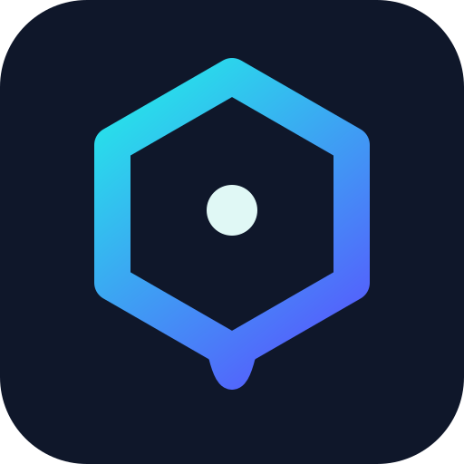
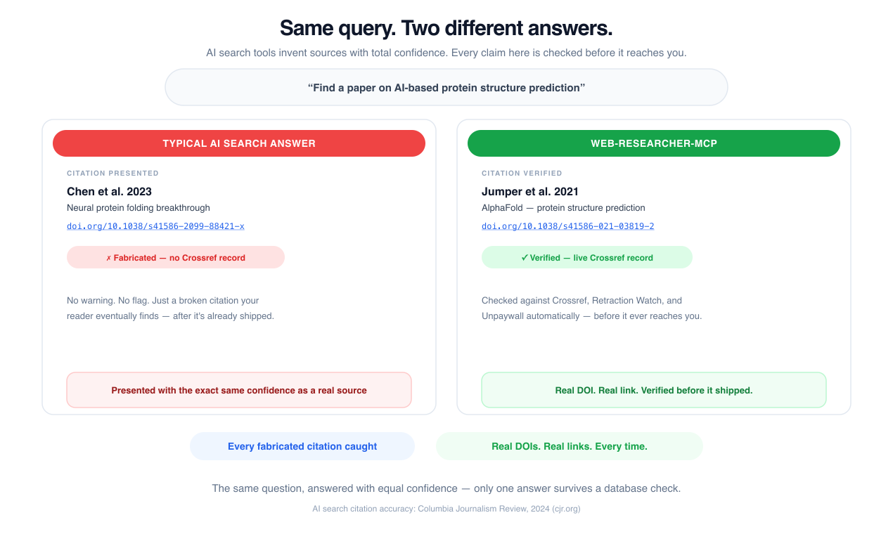
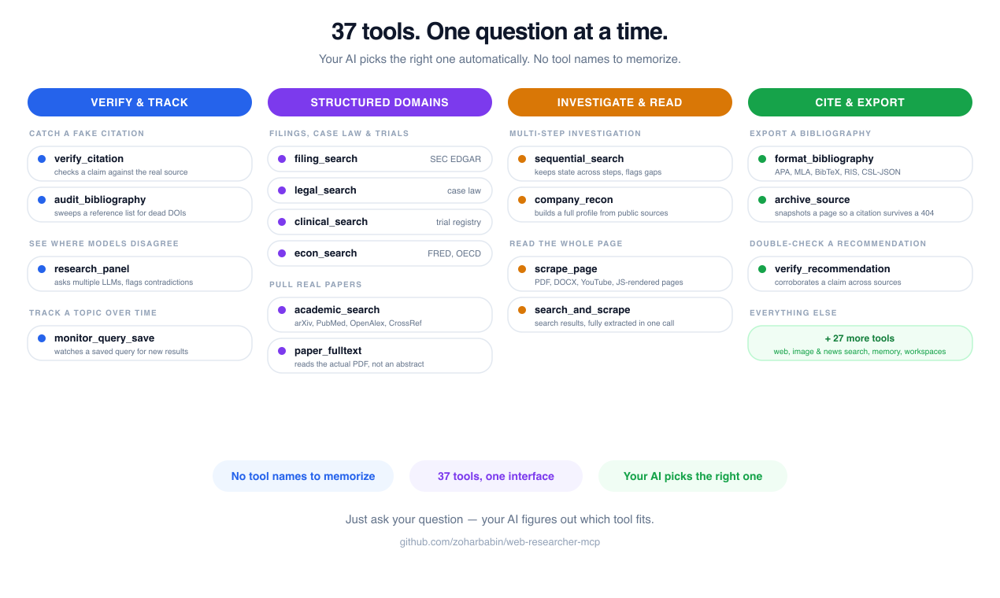
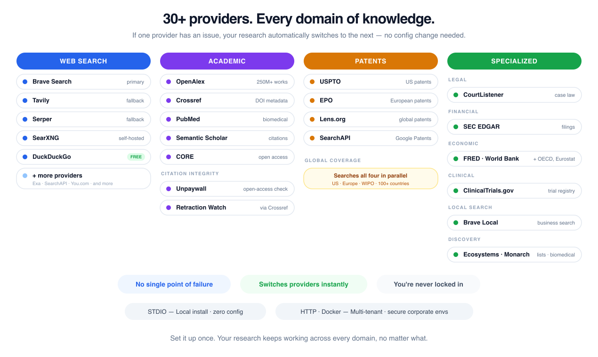

<!-- mcp-name: io.github.zoharbabin/web-researcher-mcp -->
<p align="center">
  
</p>
<h1 align="center">web-researcher-mcp</h1>
<p align="center">
  <strong>Your AI research assistant that cites real sources and stays honest.</strong>
</p>
<p align="center">
  Search the web and primary sources: SEC filings, court records, patents, clinical trials, full-text papers.<br/> Read the whole page, then check every citation before you rely on it.<br/> Runs on your machine. No API key needed to start.
</p>

⭐ If you're tired of AI making things up, and [web-researcher-mcp](https://github.com/zoharbabin/web-researcher-mcp/) helps you, give us a star ⭐ — it helps more teams discover the project.  

<p align="center">
  <a href="https://zoharbabin.com/web-researcher-mcp/"></a><br/>
  <sub>A cartoon of the problem, then real tool output. <a href="https://zoharbabin.com/web-researcher-mcp/">Watch the 43-second video</a>.</sub>
</p>

<p align="center">
  <a href="https://github.com/zoharbabin/web-researcher-mcp/actions/workflows/ci.yml"></a>
  <a href="https://goreportcard.com/report/github.com/zoharbabin/web-researcher-mcp"></a>
  <a href="https://scorecard.dev/viewer/?uri=github.com/zoharbabin/web-researcher-mcp"></a>
  <a href="https://pkg.go.dev/github.com/zoharbabin/web-researcher-mcp"></a>
  <a href="https://opensource.org/licenses/MIT"></a>
  <a href="https://github.com/zoharbabin/web-researcher-mcp/releases"></a>
  <a href="https://hub.docker.com/r/zoharbabin/web-researcher-mcp"></a>
  <a href="https://pypi.org/project/web-researcher-mcp/"></a>
  <a href="https://glama.ai/mcp/servers/zoharbabin/web-researcher-mcp"></a>
  <a href="https://github.com/zoharbabin/web-researcher-mcp/stargazers"></a>
<a href="https://mcptoplist.com/server/io.github.zoharbabin%2Fweb-researcher-mcp"></a>
</p>

### Get started in 30 seconds

**Python users — `uvx` (no compile, any OS):**
```bash
# One-time: install uv (skip if you already have it)
curl -LsSf https://astral.sh/uv/install.sh | sh        # macOS/Linux  (Windows: winget install astral-sh.uv)

claude mcp add --scope user web-researcher -- uvx web-researcher-mcp
```
[`uv`](https://docs.astral.sh/uv/) fetches the right prebuilt binary for your platform and runs it — no Go, no compile, no manual PATH. Point any MCP client at `uvx web-researcher-mcp`. Also works with `uv tool install web-researcher-mcp` or `pip install web-researcher-mcp`.

**macOS (Homebrew):**
```bash
brew install zoharbabin/tap/web-researcher-mcp
claude mcp add --scope user web-researcher -- web-researcher-mcp
```

**macOS / Linux (no package manager):**
```bash
curl -fsSL https://raw.githubusercontent.com/zoharbabin/web-researcher-mcp/main/install.sh | sh
```

**Windows (PowerShell):**
```powershell
powershell -ExecutionPolicy Bypass -c "irm https://raw.githubusercontent.com/zoharbabin/web-researcher-mcp/main/install.ps1 | iex"
```

No dev tools needed — every method ships the same signed binary (the PyPI wheels vendor it; the others download it and verify its checksum) and puts it on your PATH. The `curl`/PowerShell installers also register it with Claude Code automatically when the `claude` CLI is present; Homebrew installs the binary, so run the `claude mcp add` line above to connect it.

**One-click install:**

<p>
  <a href="https://cursor.com/en/install-mcp?name=web-researcher&config=eyJjb21tYW5kIjoidXZ4IiwiYXJncyI6WyJ3ZWItcmVzZWFyY2hlci1tY3AiXX0%3D"></a>
  <a href="https://vscode.dev/redirect?url=vscode%3Amcp%2Finstall%3F%257B%2522name%2522%253A%2522web-researcher%2522%252C%2522command%2522%253A%2522uvx%2522%252C%2522args%2522%253A%255B%2522web-researcher-mcp%2522%255D%257D"></a>
  <a href="https://lmstudio.ai/install-mcp?name=web-researcher&config=eyJjb21tYW5kIjoidXZ4IiwiYXJncyI6WyJ3ZWItcmVzZWFyY2hlci1tY3AiXX0%3D"></a>
</p>

The Cursor / VS Code / LM Studio buttons install the zero-config `uvx` setup (your editor prompts to confirm before adding it; needs [`uv`](https://docs.astral.sh/uv/) — see above). It runs **DuckDuckGo web search with no API key** — great to try instantly; `image_search`/`news_search` and richer providers need a key (2 min, see [Configuration](#configuration)). **Claude Desktop:** download the [`.mcpb` bundle](https://github.com/zoharbabin/web-researcher-mcp/releases/latest) for your platform and double-click it (Settings → Extensions), or use the `uvx` line above.

**Using a different MCP client** or want to pass API keys? See [Connect to Your AI Assistant](#connect-to-your-ai-assistant) for the per-app config, and [Configuration](#configuration) to pick a search provider.

Your AI can now search the web and primary sources, read full pages, check citations, and run multi-step research. Pick the sources you trust.

### Python SDK

```python
from web_researcher_mcp import WebResearcherClient

async with WebResearcherClient() as client:
    response = await client.web_search("CRISPR off-target effects 2024", num_results=5)
    for r in response.results:
        verified = await client.verify_citation(r.url)
        print(r.title, "—", "✓" if verified.exists else "?")
```

Full documentation: [docs/PYTHON_CLIENT.md](docs/PYTHON_CLIENT.md)

[](https://colab.research.google.com/github/zoharbabin/web-researcher-mcp/blob/main/examples/web_researcher_sdk_examples.ipynb)

Sync wrapper (for scripts and notebooks that don't use async):
```python
with WebResearcherClient.sync() as client:
    response = client.web_search("climate change 2024")
    print(response.results[0].title)
```

---

## Why does this exist?

AI answers look sourced and often aren't.

- **Courts:** the [Charlotin database](https://www.damiencharlotin.com/hallucinations/) lists over 2,200 court decisions that involve AI-hallucinated content. From 2027-01-01, [California SB 574](https://www.bakermckenzie.com/en/insight/publications/2026/10/united-states-california-imposes-new-ai-rules-on-lawyers) requires attorneys to personally verify every citation in a court filing.
- **Search:** a 2026 [WashU audit](https://source.washu.edu/2026/09/washu-research-finds-gaps-in-google-ai-overview-citations-claims/) found that about 1 in 9 verifiable claims in Google AI Overviews was not backed by the page it cited (the authors call this an upper bound). The [Tow Center at CJR](https://www.cjr.org/tow_center/we-compared-eight-ai-search-engines-theyre-all-bad-at-citing-news.php) tested eight AI search engines and found all of them bad at citing news.
- **Your work:** if it gets cited, published, filed, or shown to a client, "probably real" is not enough.

**What this does about it:** your AI reads the real pages and records, from sources you choose, and then checks the citations. Every claim traces to a link you can open.

| What you get | What that means for you |
|---|---|
| **Verify before you rely** | `verify_citation`, `audit_bibliography` and `verify_recommendation` check that a source exists, was not retracted, has a live link, and says what is claimed. They return evidence, not a verdict. Accuracy is measured on a labeled gold set ([docs/TRUST_EVAL.md](docs/TRUST_EVAL.md)). |
| **Primary sources** | Search lenses limit your AI to sites you trust. Dedicated tools cover SEC filings, US court records, patents, clinical trials, economic data and full-text papers. |
| **Reads the whole page** | PDFs, Word and PowerPoint files, YouTube transcripts and Hacker News threads, not just snippets. Optional saved logins (`site_login`, opt-in, encrypted) let it read pages you can already open. |
| **Cross-check and keep** | `research_panel` compares answers from several models. Sessions survive context loss. Export citations as APA, MLA, BibTeX, RIS or CSL-JSON. Saved-query monitors flag new results. |
| **Runs on your machine** | Free, open source (MIT), no account. Your queries go only to the search providers you choose. |
| **Always has a backup** | Several search engines work together. If one fails, the next takes over. |
| **Paper trail** | An opt-in audit log records every tool call in a tamper-evident hash chain. Releases ship with signatures and SLSA provenance. |

Works with Claude, Claude Desktop, Cursor, VS Code, Codex, Gemini CLI, and any AI assistant that supports MCP.

### Who uses this

- **Academic researchers** — "I need a literature review with real DOIs, not made-up citations"
- **Business analysts** — "My deliverable needs sources a client can actually click and verify"
- **Lawyers** — "If I cite a case that doesn't exist, I get fined $50,000"
- **Journalists** — "I need to cross-check government records and court filings, not Perplexity summaries"
- **Medical researchers** — "Clinical decisions based on a health blog could hurt someone"
- **Graduate students** — "I spent 3 hours tracking down a citation my AI invented"
- **Enterprise teams** — "Our competitive research can't go through a third party's servers"
- **Developers building agents** — "I want search and page reading without a per-query bill or a vendor lock-in"

---



---

## How It Compares

|  | web-researcher-mcp | Built-in AI search (Perplexity, ChatGPT, Google AI) | Search APIs (Tavily, Exa, Brave) | Paper tools (Scite, Consensus, Elicit) |
|---|---|---|---|---|
| Checks that citations exist, are not retracted, and say what is claimed | **Yes** | No | No | Papers only |
| You pick which sources are searched | **Yes** (lenses) | No | Domain filters | No |
| SEC filings, court records, patents, clinical trials | **Yes** | Web pages only | Web pages only | No |
| Reads full pages, PDFs, YouTube transcripts | **Yes** | Snippets and summaries | Varies | No |
| Runs on your machine, no account | **Yes** | No | No (hosted API) | No (hosted) |
| Works inside your existing AI client | **Yes** | Separate app | Yes | Partly |
| Cost | **Free**, open source (MIT) | Subscription or bundled | Metered API key | Subscription |

Based on each vendor's public docs, October 2026. If something is out of date, [open an issue](https://github.com/zoharbabin/web-researcher-mcp/issues).

### When to use what

- **Built-in AI search** — Quick casual lookups where you don't need to cite your sources
- **Search APIs** — You only need ranked links. Pair one with this tool (any of them plugs in as a provider) to also read pages and check citations
- **Paper tools** — Browsing one database of academic papers
- **web-researcher-mcp** — Anything where your reputation is attached to the research: client work, court filings, publications, grant proposals, medical decisions, journalism

---

## What your AI can do with this



| Tool | What it does |
|------|-------------|
| `web_search` | Search the web — optionally restricted to only the sources you trust via lenses |
| `scrape_page` | Read any URL in full — web pages, PDFs, Word docs, slideshows, YouTube transcripts, Hacker News threads (read natively via the HN API); supports `mode: raw` for verbatim, unsanitized source (e.g. inspecting JSON or HTML) |
| `search_and_scrape` | Search and then read the best results — with quality scoring to surface the most reliable sources |
| `image_search` | Find images by size, type, color, or format |
| `news_search` | Search recent news with date controls and source filtering |
| `academic_search` | Find real papers with real DOIs — authors, citation counts, open-access links |
| `paper_fulltext` | Fetch a paper's full text in one call from its DOI, Semantic Scholar ID, or URL — no need to chain `academic_search` then `scrape_page` |
| `citation_graph` | Walk a paper's citation neighborhood — works it cites and works that cite it, with intent/influence signals |
| `patent_search` | Search patent offices (US, Europe, international) with classification codes |
| `filing_search` | Search SEC EDGAR for US public-company filings (10-K, 10-Q, 8-K, …) — or pull structured XBRL company facts |
| `legal_search` | Search US court opinions and dockets via CourtListener — real cases with real citations |
| `econ_search` | Look up economic data — World Bank global development indicators, OECD economic indicators, Eurostat European statistics (all keyless), and FRED US macro series (GDP, CPI, unemployment, rates; requires FRED_API_KEY) |
| `clinical_search` | Search ClinicalTrials.gov — clinical-trial registrations with status, phase, sponsor, and whether results are posted (discovery, not medical advice) |
| `monarch_search` | Query the Monarch Initiative biomedical knowledge graph — rank diseases and genes by phenotype similarity, look up disease/gene/phenotype entities, traverse gene-disease-phenotype associations |
| `awesome_list_search` | Search the ecosyste.ms Awesome API for community-curated "awesome-*" lists on a GitHub topic — structured, filterable coverage (stars, curated-entry count, topics) beyond free-text search |
| `local_search` | Search for physical places (restaurants, shops, services, points of interest) by local intent query — structured POI details and descriptions. Requires `BRAVE_API_KEY` |
| `brand_research` | Research a company's complete brand identity — colors (hex), logos, typography, tone of voice, and social handles — from any domain or company name. Returns structured JSON for AI content generation. No API key required; BrandFetch key optional for richer data |
| `company_recon` | OSINT company reconnaissance — Certificate Transparency log SANs, Wayback Machine historical URL inventory, derived subdomains, and a web-search company summary. Each phase fails soft and is independently selectable |
| `verify_citation` | Check a citation before you rely on it — does it exist, match a real record, and is it retracted or a dead link? Evidence, not a verdict |
| `audit_bibliography` | Audit a whole reference list in one pass — paste a CSL-JSON/RIS/BibTeX file (or a session) and get per-entry + corpus-level flags for retracted, dead-link, and unverifiable citations |
| `verify_recommendation` | Audit an AI-generated recommendation list (listicle, product ranking) for self-promotion, author conflicts of interest, domain reputation, and dead links — catches GEO-gamed picks. Evidence, not a verdict |
| `archive_source` | Capture a fresh Internet Archive (Wayback Machine) snapshot of a URL via Save Page Now so a cited source stays verifiable if the page later changes or disappears — returns snapshot URL + timestamp (write tool) |
| `sequential_search` | Multi-step deep research — your AI remembers what it already found and builds on it |
| `get_research_session` | Recover a research session after context loss — picks up right where you left off |
| `research_export` | Export a research session as a shareable report (markdown or JSON), with full per-step provenance |
| `format_bibliography` | Turn collected sources into a formatted bibliography — APA, MLA, BibTeX, RIS, or CSL-JSON (Zotero/EndNote/Mendeley-ready) |
| `research_panel` | Ask the same question to a panel of independently configured LLMs and compare answers — consensus, contradictions, and model-unique points, computed deterministically, never smoothed over by an arbiter model |

Most tools above are always available. A few activate only when the right provider or config is present: `citation_graph` and `research_panel` require at least one configured backing provider; `filing_search` requires `EDGAR_CONTACT_EMAIL`; `local_search` requires `BRAVE_API_KEY`.

**Opt-in tools.** These stay off until you turn the feature on. Personal-data features also need recorded consent.

| Tool | What it does | Turn on with |
|------|-------------|--------------|
| `site_login`, `site_logout` | Save or remove a login (cookies or a browser profile) so `scrape_page` can read pages behind it. Encrypted, per user. | `COOKIE_VAULT_ENABLED=true` |
| `monitor_query_save`, `monitor_query_check` | Save a query, then ask later for only the results that are new | `MONITORING_ENABLED=true` |
| `memory_save`, `memory_recall` | Keep findings across sessions, per user, with a retention limit | `MEMORY_ENABLED=true` |
| `workspace_contribute`, `workspace_read` | Share findings into a team workspace, with provenance | `WORKSPACES_ENABLED=true` |
| `get_my_analytics` | See your own usage stats | `USER_ANALYTICS_ENABLED=true` |

See [`docs/TOOLS.md`](docs/TOOLS.md) for the authoritative, CI-verified tool list and full schemas.

### Ready-made research templates

The server also ships guided **prompt templates** your AI assistant can pull in with one click — they walk it through a proven, multi-step process so you don't have to spell out every instruction:

| Template | What it guides your AI to do |
|----------|------------------------------|
| `comprehensive-research` | Run a structured, multi-step deep dive on a topic |
| `fact-check` | Verify a claim against multiple independent sources |
| `competitive-analysis` | Size up a company and its market (news, patents, web) |
| `literature-review` | Systematically review academic literature on a topic |
| `brand-guidelines` | Research a brand and produce use-case-specific creative direction (landing page, email, video brief) — calls `brand_research` and interprets the structured JSON for you |
| `company-recon` | Deep OSINT reconnaissance on a company — maps infrastructure, filings, personnel, and public footprint |
| `rare-disease-research` | Rare-disease differential and gene-disease research over the Monarch knowledge graph, corroborated with literature and trials |
| `research-panel-factcheck` | Fact-check a claim across a panel of LLMs and chase every disagreement |
| `research-panel-synthesis` | Synthesize one answer across a panel of LLMs, treating contradictions as uncertainty |
| `curriculum-research` | Research a subject's syllabus coverage, institutional climate, and academic-freedom context — calls `web_search` with the `curriculum` lens |

In most AI apps these show up wherever you pick a prompt or "/" command. The server exposes live **status resources** (`stats://tools`, `stats://sessions`, `stats://rate-limits`, `stats://providers`), a lens catalog (`lenses://catalog`), diagnostics (`diagnostics://errors/recent`, `diagnostics://health`, `diagnostics://panel/spend`), and a large-payload artifact store (`research://artifact/{id}`) so you — or your AI — can check usage, limits, and which providers are active. See [docs/DEPLOYMENT.md](docs/DEPLOYMENT.md#mcp-resources--prompts) for the full list.

---

## Quick Start

### Option 1: Homebrew (macOS / Linux — recommended)

```bash
brew install zoharbabin/tap/web-researcher-mcp
claude mcp add --scope user web-researcher -- web-researcher-mcp
```

Homebrew handles trust, updates, and PATH for you — no signing warnings.

### Option 2: One-command install (any OS — no dev tools needed)

**macOS / Linux:**
```bash
curl -fsSL https://raw.githubusercontent.com/zoharbabin/web-researcher-mcp/main/install.sh | sh
```

**Windows (PowerShell):**
```powershell
powershell -ExecutionPolicy Bypass -c "irm https://raw.githubusercontent.com/zoharbabin/web-researcher-mcp/main/install.ps1 | iex"
```

Downloads the binary, verifies its SHA-256 checksum against the signed release, puts it on your PATH, and registers it with Claude Code if installed. Customize the install location:

```bash
INSTALL_DIR=/opt/tools curl -fsSL https://raw.githubusercontent.com/zoharbabin/web-researcher-mcp/main/install.sh | sh
```

<details>
<summary><strong>Other install methods</strong></summary>

**AUR (Arch Linux):**
```bash
# Using any AUR helper (yay, paru, etc.)
yay -S web-researcher-mcp
```
Or manually: `git clone https://aur.archlinux.org/web-researcher-mcp.git && cd web-researcher-mcp && makepkg -si`

**Nix / NixOS:**
```bash
# Run without installing
nix run github:zoharbabin/web-researcher-mcp

# Add to your flake inputs
nix profile install github:zoharbabin/web-researcher-mcp
```
See [`packaging/nix/flake.nix`](packaging/nix/flake.nix) for NixOS module usage.

**Continue.dev:**  
Add to your Continue `~/.continue/config.json`:
```json
{
  "mcpServers": {
    "web-researcher": {
      "command": "uvx",
      "args": ["web-researcher-mcp"]
    }
  }
}
```
Or copy [`packaging/continue/config.json`](packaging/continue/config.json) as a starting point.

**WinGet (Windows):**
```powershell
winget install zoharbabin.web-researcher-mcp
```

**Scoop (Windows):**
```powershell
scoop bucket add zoharbabin https://github.com/zoharbabin/scoop-bucket
scoop install web-researcher-mcp
```

**Chocolatey (Windows):**
```powershell
choco install web-researcher-mcp
```

**Homebrew Cask (macOS — Developer ID-signed + notarized binary):**
```bash
brew install --cask zoharbabin/tap/web-researcher-mcp
```
The cask ships the notarized darwin binary (Gatekeeper-clean). Most users want the formula above (`brew install zoharbabin/tap/web-researcher-mcp`), which the bare name resolves to; pass `--cask` explicitly for the notarized artifact.

**Go install** (if you have Go):
```bash
go install github.com/zoharbabin/web-researcher-mcp/cmd/web-researcher-mcp@latest
claude mcp add --scope user web-researcher -- web-researcher-mcp
```

**Docker:**
```bash
# STDIO mode needs -i so the container's stdin stays attached for MCP JSON-RPC
docker run -i --rm \
           -e SEARCH_PROVIDER=brave \
           -e BRAVE_API_KEY=YOUR_KEY \
           docker.io/zoharbabin/web-researcher-mcp:latest
```

**Build from source:**
```bash
git clone https://github.com/zoharbabin/web-researcher-mcp.git
cd web-researcher-mcp
go build -o web-researcher-mcp ./cmd/web-researcher-mcp
```

</details>

### Connect to Your AI Assistant

The install script registers with Claude Code automatically. For other apps, add to your AI's config file:

```json
{
  "mcpServers": {
    "web-researcher": {
      "command": "web-researcher-mcp",
      "env": {
        "SEARCH_PROVIDER": "brave",
        "BRAVE_API_KEY": "YOUR_BRAVE_API_KEY"
      }
    }
  }
}
```

No key yet? Leave `env` out. DuckDuckGo works with no setup.

**Other clients:**

| Client | Where |
|---|---|
| Gemini CLI | `gemini mcp add web-researcher uvx web-researcher-mcp`, or the JSON block above in `~/.gemini/settings.json` |
| Codex | `~/.codex/config.toml`: `[mcp_servers.web-researcher]` with `command = "uvx"` and `args = ["web-researcher-mcp"]` |

Swap in any provider from the [Configuration](#configuration) table by setting `SEARCH_PROVIDER` and that provider's key. Done — your AI assistant now has access to all research tools.

---

## Configuration



**No API key required.** DuckDuckGo is the built-in zero-config fallback — install and go. To raise result quality and unlock image/news search, add **any one** of the providers below. They're all optional and interchangeable — pick whichever you already use or prefer; the server treats them equally.

### Search providers

Set `SEARCH_PROVIDER=<name>` and supply that provider's key. Every provider works with [search lenses](#search-lenses), and any of them can be combined for automatic failover (see [Search Providers](#search-providers)).

| Provider | `SEARCH_PROVIDER` | Key variable(s) | Get a key |
|----------|-------------------|-----------------|-----------|
| DuckDuckGo | `duckduckgo` | none | Built in — zero config |
| Google PSE | `google` | `GOOGLE_CUSTOM_SEARCH_API_KEY` + `GOOGLE_CUSTOM_SEARCH_ID` | [cloud console](https://console.cloud.google.com/) + [engine](https://programmablesearchengine.google.com/) |
| Brave | `brave` | `BRAVE_API_KEY` | [brave.com/search/api](https://brave.com/search/api/) |
| Serper | `serper` | `SERPER_API_KEY` | [serper.dev](https://serper.dev/) |
| SearchAPI.io | `searchapi` | `SEARCHAPI_API_KEY` | [searchapi.io](https://www.searchapi.io/) |
| You.com | `youcom` | `YOUDOTCOM_API_KEY` | [you.com/docs/api-reference/search/v1-search](https://you.com/docs/api-reference/search/v1-search) |
| SearXNG | `searxng` | `SEARXNG_URL` | [self-hosted](https://docs.searxng.org/) |
| Tavily | `tavily` | `TAVILY_API_KEY` | [app.tavily.com](https://app.tavily.com/) |
| Exa | `exa` | `EXA_API_KEY` | [dashboard.exa.ai](https://dashboard.exa.ai/) |
| Hacker News | `hackernews` | none | Built in — zero config (HN Algolia index) |
| Reddit | `reddit` | none | Built in — zero config (public RSS) |
| Bluesky | `bluesky` | none | Built in — zero config (public AT Protocol API) |
| GitHub | `github` | none (`GITHUB_TOKEN` optional, raises rate limit) | Built in — zero config (public REST Search API) |
| Xquik | `xquik` | `XQUIK_API_KEY` | [dashboard.xquik.com](https://dashboard.xquik.com/) |

> **Google PSE is ending.** Google closed its Custom Search JSON API to new customers and shuts it down on 2027-01-01 ([Google](https://developers.google.com/custom-search/v1/overview)). Existing keys work until then. For new setups, use Brave, Serper, SearXNG, or another provider.

> Each provider has its own free tier, signup flow, and capability mix (images, news, freshness). See **[docs/PROVIDERS.md](docs/PROVIDERS.md)** for a full comparison (index classification, capability matrix, quick-pick guide) and **[docs/API_SETUP.md](docs/API_SETUP.md)** for step-by-step key setup. Set up more than one and the server fails over automatically — see [Search Providers](#search-providers).

When `SEARCH_PROVIDER` is unset, the server uses Google if its keys are present and otherwise falls back to the zero-config DuckDuckGo provider — so it always works out of the box, with or without keys.

### Academic Search (Optional — no signup needed)

Academic search providers (OpenAlex, CrossRef) accept a contact email to unlock faster access via the polite pool — no registration, just an email. See [docs/API_SETUP.md](docs/API_SETUP.md) for setup and [docs/DEPLOYMENT.md](docs/DEPLOYMENT.md#environment-variables) for the full variable reference.

> With these set, `academic_search` returns real papers with DOIs, authors, citation counts, and open-access PDF links. Without them, it still works but uses web search as a fallback.

### Patent Search (Optional)

Patent providers (EPO, USPTO, The Lens) require API keys for structured patent data. See [docs/API_SETUP.md](docs/API_SETUP.md) for step-by-step setup and [docs/DEPLOYMENT.md](docs/DEPLOYMENT.md#environment-variables) for the full variable reference.

> With these, `patent_search` returns structured patent data with classification codes, dates, and inventors. Without them, it falls back to web search.

<details>
<summary><strong>Advanced: HTTP mode, OAuth, and all other settings</strong></summary>

HTTP mode, OAuth, rate limiting, cache, scraping, and observability settings are documented in [docs/DEPLOYMENT.md](docs/DEPLOYMENT.md#environment-variables).

</details>

---

## Under the Hood

<details>
<summary><strong>Architecture (for developers and contributors)</strong></summary>

The full per-package map and the layered diagram (MCP transports → tool dispatch → service layer → infrastructure) live in **[ARCHITECTURE.md](ARCHITECTURE.md)** — kept in one place to avoid drift.

<details>
<summary><strong>Design Principles (for developers)</strong></summary>

1. **Zero global state** -- all dependencies injected via constructors
2. **Interface-driven** -- every external dependency behind an interface for testing and swapping
3. **Bounded concurrency** -- explicit semaphores for external API calls
4. **Defense in depth** -- SSRF protection, rate limiting, content sanitization at every layer
5. **Fail loud** -- errors returned, never swallowed; validation at boundaries

</details>

</details>

---

## Search Providers

You choose which search engine powers your research. All of them work with lenses.

| Provider | Whole-Web | Images | News | Notes |
|----------|:---------:|:------:|:----:|-------|
| **DuckDuckGo** | Yes | — | — | Zero-config default (no API key needed); rate-limited for heavy use |
| **Google PSE** | Yes | Yes | Yes | Closed to new customers; ends 2027-01-01. Free tier: 100 queries/day |
| **Brave Search** | Yes | Yes | Yes | Independent index; free tier available |
| **Serper.dev** | Yes | Yes | Yes | Google-identical results |
| **SearXNG** | Yes | Yes | Yes | Self-hosted, privacy-first, air-gapped deployments |
| **SearchAPI.io** | Yes | Yes | Yes | Unified API with multiple engine backends |
| **You.com** | Yes | — | Yes | Web and news search via the You.com API |
| **Tavily** | Yes | — | Yes | AI-agent search; clean, LLM-ready content |
| **Exa** | Yes | — | Yes | Neural/semantic search; also backs `academic_search` and the optional paid scrape tier |
| **Hacker News** | HN only | — | Yes | Zero-config (HN Algolia index); searches HN threads, not the full web |
| **Reddit** | Reddit only | — | Yes | Zero-config (public RSS); searches Reddit posts, not the full web |
| **Bluesky** | Bluesky only | — | — | Zero-config (public AT Protocol API); searches Bluesky posts, not the full web |
| **GitHub** | GitHub only | — | Yes | Zero-config (public REST Search API); searches issues/PRs, not the full web |
| **Xquik** | X/Twitter only | — | Yes | Searches X posts, not the full web; needs `XQUIK_API_KEY` |

### Multiple Providers (recommended)

Set up multiple search engines so if one has issues, your research doesn't stop:

```bash
export SEARCH_ROUTING=brave,serper,duckduckgo
```

If Brave is down, it automatically tries Serper. If Serper is rate-limited, it falls through to DuckDuckGo. Your research just works.

See **[docs/PROVIDERS.md](docs/PROVIDERS.md)** for a full provider comparison (index classification, capabilities, free tiers) and [docs/DEPLOYMENT.md](docs/DEPLOYMENT.md#multi-provider-routing) for advanced routing options (per-topic routing, patent-specific providers, etc.).

### Single Provider

If you only have one search API key, that works too — just set it up and go.

<details>
<summary><strong>Provider Setup Examples</strong></summary>

**Multi-provider routing (recommended):**
```bash
export SEARCH_ROUTING=brave,serper
export BRAVE_API_KEY=BSAxxxxxxxxxx
export SERPER_API_KEY=...
```

**Single provider — Brave Search:**
```bash
export SEARCH_PROVIDER=brave
export BRAVE_API_KEY=BSAxxxxxxxxxx
```

**Single provider — SearXNG (self-hosted, privacy-first):**
```bash
export SEARCH_PROVIDER=searxng
export SEARXNG_URL=http://localhost:8080
```

**Single provider — Exa:**
```bash
export SEARCH_PROVIDER=exa
export EXA_API_KEY=...
```

**Single provider — Brave:**
```bash
export SEARCH_PROVIDER=brave
export BRAVE_API_KEY=BSA...
```

Any provider from the [Configuration](#configuration) table works the same way — set `SEARCH_PROVIDER` and its key(s).

</details>

---

## Search Lenses

Search lenses let you control which websites your AI is allowed to search. Instead of searching the entire web (and getting blogs, spam, and AI-generated junk), a lens restricts results to only the sources you trust for that topic.

### Built-in Lenses

| Lens | Focus |
|------|-------|
| `docs` | Official documentation and API references only |
| `academic` | Preprint servers, repositories, open-access journals |
| `academic-extended` | Preprint servers, OA aggregators, and repositories beyond core journal indexes |
| `biomed` | Rare-disease and biomedical knowledge-graph sources — ontology portals, gene-disease databases, curated rare-disease registries |
| `clinical` | Clinical trials, drug safety, evidence-based medicine |
| `curriculum` | Academic curriculum data, institutional free speech climate, and global education statistics |
| `security` | CVEs, advisories, vulnerability research |
| `investigative_records` | Public records, corporate filings, FOIA |
| `programming` | Code docs, tutorials, Q&A |
| `programming-goggle` | Developer-first results re-ranked by Brave's Programming Goggle — surfaces docs, repos, and authoritative technical content (requires Brave) |
| `devops` | Infrastructure and operations — Kubernetes, Docker, Terraform, cloud, CI/CD |
| `news` | Current events, journalism |
| `tech` | Technology industry |
| `legal` | Law, cases, statutes |
| `medical` | Health, medicine |
| `finance` | Markets, filings |
| `science` | Research, papers |
| `government` | Policy, regulations |
| `osint` | Open-source intelligence — public records, corporate registries, social footprint, infrastructure |
| `awesome-lists` | Community-curated "awesome-*" lists on GitHub — PR-reviewed tool and resource collections across every domain |

You can also [create your own lenses](#search-lenses) for any field — just list the domains you trust.

### How it works

When you (or your AI) use a lens, results come only from the sites in that lens. For example, using the `medical` lens means your AI searches PubMed, WHO, NIH, and other clinical sources — never health blogs or supplement ads.

Your AI uses lenses automatically when you ask it to. For example: *"Search for recent findings on SGLT2 inhibitors using the clinical lens."*

<details>
<summary><strong>Creating Your Own Lens</strong></summary>

Create a directory for your custom lenses and add a JSON file for each one:

```json
{
  "name": "my-industry",
  "description": "Only searches sources I trust for my field",
  "domains": [
    "trusted-source.com",
    "industry-journal.org",
    "official-database.gov"
  ],
  "cx": ""
}
```

Then point the server to your lens directory:

```bash
export CUSTOM_LENSES_PATH=/path/to/my-lenses
```

Your AI will now have `my-industry` as an available lens. Custom lenses load after the built-in set — a custom lens with the same `name` as a built-in one overrides it. You can add up to ~10 domains per lens.

**Advanced options** (optional — most users can ignore these):
- **cx** — Marks the lens as scoped by a Google Programmable Search Engine. The lens then skips `site:` injection. Set that engine as the global `GOOGLE_CUSTOM_SEARCH_ID`. Google's API ends 2027-01-01, so prefer `domains` lenses
- **goggle** — A Brave Goggle URL for server-side re-ranking (Brave only)

</details>

---

## Privacy & Security

Your research queries go directly from your machine to the search provider you chose. They never pass through our servers (we don't have servers). The tool runs entirely on your computer.

Features that store personal data (saved logins, memory, analytics, workspaces) are off by default. Each needs an opt-in, a recorded consent, and encrypted storage.

<details>
<summary><strong>Technical security details (for enterprise / compliance teams)</strong></summary>

- **SSRF protection** — blocks internal network access, cloud metadata endpoints, DNS rebinding attacks
- **OAuth 2.1** (HTTP mode) — JWKS token validation, per-tenant isolation, audience/issuer validation
- **Rate limiting** (HTTP mode) — per-tenant + global limits to protect upstream APIs
- **Content sanitization** — HTML cleaned via whitelist policy, deduplication, quality scoring

For the full threat model, see [docs/SECURITY.md](docs/SECURITY.md).

</details>

---

## Setup for Each AI App

### Claude Code

Add to your MCP config (`~/.claude.json`). Set `SEARCH_PROVIDER` and the matching key for whichever provider you use (see the [Configuration](#configuration) table) — this example uses Brave:

```json
{
  "mcpServers": {
    "web-researcher": {
      "command": "/path/to/web-researcher-mcp",
      "env": {
        "SEARCH_PROVIDER": "brave",
        "BRAVE_API_KEY": "BSA..."
      }
    }
  }
}
```

### Claude Desktop

Add to `~/Library/Application Support/Claude/claude_desktop_config.json` (macOS) or `%APPDATA%\Claude\claude_desktop_config.json` (Windows):

```json
{
  "mcpServers": {
    "web-researcher": {
      "command": "/path/to/web-researcher-mcp",
      "env": {
        "SEARCH_PROVIDER": "brave",
        "BRAVE_API_KEY": "BSA..."
      }
    }
  }
}
```

### Cursor

Add to `.cursor/mcp.json` in your project root:

```json
{
  "mcpServers": {
    "web-researcher": {
      "command": "/path/to/web-researcher-mcp",
      "env": {
        "SEARCH_PROVIDER": "brave",
        "BRAVE_API_KEY": "BSA..."
      }
    }
  }
}
```

### HTTP Mode (Teams / Shared Server)

For teams that want one shared instance everyone connects to:

```bash
PORT=3000 \
OAUTH_ISSUER_URL=https://auth.example.com \
OAUTH_AUDIENCE=https://api.example.com \
./web-researcher-mcp
```

Then connect any AI app to `http://localhost:3000/mcp/`.

<details>
<summary><strong>Docker Compose Example</strong></summary>

```yaml
services:
  web-researcher:
    image: zoharbabin/web-researcher-mcp
    ports:
      - "3000:3000"
    environment:
      PORT: "3000"
      SEARCH_PROVIDER: brave
      BRAVE_API_KEY: ${BRAVE_API_KEY}
```

</details>

> **Note:** Tool behavior is identical across all connection modes (STDIO and HTTP). The only differences are auth (HTTP requires OAuth) and rate limiting (HTTP enforces per-tenant limits; STDIO has only upstream API quotas). See [docs/DEPLOYMENT.md](docs/DEPLOYMENT.md) for details.

---

## Performance

Searches come back in under a second. Previously-seen results are cached so repeats are instant. Full article extraction works on 95%+ of the web — including sites that try to block bots. Heavy JavaScript sites get a real browser behind the scenes (automatic, no setup needed).

---

## Development

```bash
go build -o web-researcher-mcp ./cmd/web-researcher-mcp   # Build
go test -race ./...                                        # Test (with race detector)
make verify                                                # Full CI gate (see Makefile for steps)
```

The lint, gosec, and govulncheck tools are pinned as `go.mod` tool directives, so `make verify` runs them at the exact versions CI uses (no global installs needed). Branch protection requires the Lint, Test, Security, and E2E checks to pass.

See [CONTRIBUTING.md](CONTRIBUTING.md) for the full development workflow, code style guide, and PR process.

---

## Troubleshooting

<details>
<summary><strong>Server starts but tools fail with "API key" errors</strong></summary>

The server starts even with missing credentials (to allow MCP handshake). Set your API keys in the `env` block of your MCP client config, not in your shell profile.

</details>

<details>
<summary><strong>Some pages come back empty</strong></summary>

For JavaScript-heavy sites, the tool uses a real browser (Chromium). With the binary install it auto-downloads on first use (~200MB). If you already have Chrome installed, set `CHROME_PATH` to point to it. The Docker image ships with Chromium bundled (`CHROME_PATH` preset), so JavaScript rendering works out of the box — no download.

</details>

<details>
<summary><strong>Cache serving stale results after upgrade</strong></summary>

The disk cache lives at your OS cache directory (e.g., `~/Library/Caches/web-researcher-mcp/` on macOS, `~/.cache/web-researcher-mcp/` on Linux). Delete that directory to clear it, or set `CACHE_DIR` to a custom path.

</details>

<details>
<summary><strong>Hitting search limits (429 errors)</strong></summary>

If your provider's free tier runs out:
- Switch to a different provider — set `SEARCH_PROVIDER` to any other option (see [Configuration](#configuration)); each has its own free tier
- Set up multiple providers (e.g. `SEARCH_ROUTING=brave,serper`) — if one is rate-limited, it automatically falls through to the next
- Or upgrade your provider's plan

</details>

<details>
<summary><strong>macOS: "Failed to reconnect" / error -32000 after a manual update</strong></summary>

This happens only if you replaced the binary by copying new bytes *over* the existing file in place (`cp new /path/to/web-researcher-mcp`). On Apple Silicon, macOS caches the binary's ad-hoc code signature against the file, and overwriting it in place can make the next launch get killed before it starts. The official installers (Homebrew, the one-command `install.sh`, and the Claude Code plugin) avoid this by installing to a fresh file. To fix a manual install, replace it cleanly and re-sign:

```bash
rm -f /path/to/web-researcher-mcp
cp /path/to/new-build /path/to/web-researcher-mcp
codesign --force -s - /path/to/web-researcher-mcp   # ad-hoc re-sign
```

Then reconnect your client. (Re-running `install.sh` does this correctly for you.)

</details>

---

## Contributing

Contributions are welcome. Please see [CONTRIBUTING.md](CONTRIBUTING.md) for code style guidelines, development workflow, and how to submit pull requests.

---

## Documentation

| Document | Description |
|----------|-------------|
| [ARCHITECTURE.md](ARCHITECTURE.md) | Design decisions, technology stack, dependencies |
| [CONTRIBUTING.md](CONTRIBUTING.md) | Development setup, code style, PR workflow |
| [docs/TOOLS.md](docs/TOOLS.md) | Tool specifications and parameter schemas |
| [docs/EXAMPLES.md](docs/EXAMPLES.md) | Usage examples with JSON tool calls |
| [docs/API_SETUP.md](docs/API_SETUP.md) | Search provider API key setup for all providers |
| [docs/SECURITY.md](docs/SECURITY.md) | Threat model, SSRF, auth, compliance (SOC2/GDPR/FedRAMP) |
| [docs/PRIVACY.md](docs/PRIVACY.md) | What data goes where, third-party processors, retention |
| [docs/DEPLOYMENT.md](docs/DEPLOYMENT.md) | Build, Docker, Kubernetes, client configs, scaling |
| [docs/PYTHON_CLIENT.md](docs/PYTHON_CLIENT.md) | Python SDK — WebResearcherClient reference, sync wrapper, installation |
| [docs/LESSONS_LEARNED.md](docs/LESSONS_LEARNED.md) | Node.js to Go migration story and lessons |
| [docs/SESSION_PERSISTENCE.md](docs/SESSION_PERSISTENCE.md) | How sessions survive context loss — design, data flow, citations |
| [docs/MIGRATION.md](docs/MIGRATION.md) | Migrating from the deprecated google-researcher-mcp |

---

## License

[MIT](LICENSE)

---

<p align="center">
  Built by <a href="https://zoharbabin.com">Zohar Babin</a>, with <a href="https://go.dev">Go</a> and the <a href="https://modelcontextprotocol.io/">Model Context Protocol</a>
</p>
